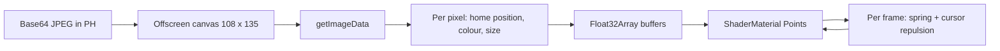

# Srivathsa Sherla — Portfolio

Personal portfolio of Srivathsa Sherla, a B.Tech Computer Science and Engineering (AI & ML) student at Newton School of Technology, S-VYASA University, Bengaluru. The site is a single static `index.html` with no build step. Its centrepiece is a portrait rendered as a WebGL particle field that reacts to the cursor.


[](https://github.com/srivathsa12/my-portfolio/actions)


**Live site:** https://srivathsa12.github.io/my-portfolio/

## Contents

1. [Overview](#overview)
2. [Page structure](#page-structure)
3. [Architecture](#architecture)
4. [Dependencies](#dependencies)
5. [Content data model](#content-data-model)
6. [Run locally](#run-locally)
7. [Deploy to GitHub Pages](#deploy-to-github-pages)
8. [Customise](#customise)
9. [Accessibility and motion](#accessibility-and-motion)
10. [Performance notes](#performance-notes)
11. [Testing](#testing)
12. [Known limitations](#known-limitations)
13. [Contact](#contact)

## Overview

The goal is a portfolio that shows engineering rather than describing it. Everything a visitor sees is built by hand in one file: markup, styles and scripts. The only runtime dependencies are Three.js for the WebGL layer and the Inter typeface.

Design decisions:

- **One file.** No bundler, no package manager, no framework. The repository can be cloned and served as is.
- **Content as data.** Projects, stats, learning modules and skill tags live in plain JavaScript arrays, so copy changes never touch rendering code.
- **Honest status labels.** Each project is marked as built, as a repository, or as a concept design, so the page does not overstate what exists.

## Page structure

| Section | Anchor | Content | Interaction |
| --- | --- | --- | --- |
| Hero | `#top` | Headline, short bio, links, particle portrait | Per-letter 3D headline, typing ticker, photo lens, click to scatter the portrait |
| Marquee | | Eight technology names | Skews in proportion to scroll velocity |
| About | `#about` | Bio, education card, profile card | Profile card flips on click and shows contact details on the back |
| Skills | `#skills` | Four skill groups and 18 tags | Draggable 3D tag sphere |
| Projects | `#work` | Six project cards | 3D tilt, holographic sheen, code window per card |
| Impact | `#impact` | Newton School portal statistics | Count-up numbers, progress rings, segmented XP bar |
| Learning | `#learning` | Six modules (courses, workshops, coursework) | Terminal with typed commands and clickable modules |
| Contact | `#contact` | Email, LinkedIn, GitHub | Copy-to-clipboard button, magnetic buttons |
| Footer | | Copyright, Bengaluru local time (IST), back-to-top link | Clock updates every 15 seconds |

Site-wide behaviour: an intro curtain, a scroll-progress bar in the navigation, active-section highlighting, a soft cursor light and ring (disabled on touch devices), a film-grain overlay, and the keys `1` to `6` to jump between sections.

### Learning terminal commands

| Command | Result |
| --- | --- |
| `help` | List commands |
| `ls` | List the six modules |
| `cat <module>` | Open a module: `python`, `git`, `100days`, `genai`, `evals`, `agentic` |
| `tour` | Walk through every module in order |
| `projects` | Print repository links |
| `whoami` | Short profile |
| `github` | Profile and repository links |
| `about`, `skills`, `work`, `impact`, `contact` | Scroll to that section |
| `clear` | Clear the screen |

The up and down arrow keys step through command history. The module cards on the left run the same commands.

## Architecture

The file has three parts in order: markup, a single `<style>` block, and two scripts (the Three.js library, then the page script).

The page script is organised as commented blocks that run top to bottom:

| Block | Responsibility |
| --- | --- |
| Headline | Splits the `<h1>` into letters and updates a CSS variable per letter from cursor distance |
| Typing ticker | Cycles four command strings in the hero |
| Portrait lens | A DOM circle that follows the pointer and shows the unmodified photo, aligned with `background-position` |
| Projects | Builds the cards from the `P` array |
| Stats | Builds the stat cards from the `S` array, animates rings, segments and counters |
| Learning terminal | Command parser, module output, history and the 100-cell day grid |
| Skill sphere | Places tags on a Fibonacci sphere and rotates them with plain trigonometry |
| Interaction layer | Card tilt, holographic sheen, magnetic buttons, cursor light, navigation state |
| Final touches | Cursor ring, marquee skew, contact marquee, copy-email, IST clock, keyboard shortcuts |
| Three.js scene | Particle portrait, drifting node network, gyroscope rings |

### Particle portrait pipeline



Each pixel becomes one point. Brightness controls dot size and depth, so the image reads as a halftone relief. Each frame, every point is pulled toward its home position by a spring and pushed away from the cursor inside a fixed radius. A click adds a random velocity impulse to every point, and the springs pull the portrait back together.

The group is positioned from the on-screen rectangle of the portrait element, so the WebGL layer follows the page as it scrolls.

## Dependencies

Everything lives in `index.html` except two runtime resources.

| Dependency | Version | Source | Used for |
| --- | --- | --- | --- |
| Three.js | r128 | cdnjs.cloudflare.com | Particle portrait, network, rings |
| Inter | weights 300, 400, 500, 700 | Google Fonts | Typography, with a system sans-serif fallback |

The portrait is embedded as a base64 JPEG in the `PH` constant, which is why the file is about 147 KB. Embedding also avoids cross-origin restrictions when the image is read into a canvas.

## Content data model

All page content is defined as arrays near the relevant script block.

**Projects, `P`**

```js
[title, description, statusPill, techPill, codeSnippet, repoUrl]
// repoUrl is "" for projects without a public repository
```

**Impact stats, `S`**

```js
[label, value, suffix, ringFraction, caption]
// ringFraction is 0 to 1. The "Total XP" entry renders as a segmented bar instead of a ring.
```

**Learning modules, `M`** (inside the terminal block)

```js
[key, title, provider, type, description, skills[], outputLines[]]
// outputLines may be ["GRID"] to render the 100-cell day grid
```

**Skill sphere, `L`**: an array of 18 strings.

## Run locally

```bash
git clone https://github.com/srivathsa12/my-portfolio.git
cd my-portfolio
python3 -m http.server 8000
```

Open http://localhost:8000. Opening `index.html` directly also works. An internet connection is needed for Three.js and Inter.

## Deploy to GitHub Pages

1. Make sure the repository is public.
2. Go to **Settings → Pages → Build and deployment**.
3. Set **Source** to **Deploy from a branch**.
4. Set **Branch** to `main` and the folder to `/ (root)`, then click **Save**.
5. Wait for the "pages build and deployment" run in the **Actions** tab to finish, then open the live URL.

The site uses no relative asset paths, so it works under the `/my-portfolio/` subpath.

| Symptom | Cause | Fix |
| --- | --- | --- |
| "There isn't a GitHub Pages site here" | Pages is not enabled, or the branch selector is still `None` | Complete steps 2 to 4 |
| Pages options are greyed out or ask to upgrade | The repository is private | Change visibility to public |
| 404 right after saving | The first build has not finished | Check the Actions run, then hard refresh |
| Page loads but the 3D portrait is missing | The Three.js CDN is blocked or offline | Check the browser console and network tab |

## Customise

| To change | Edit |
| --- | --- |
| Portrait | The `PH` constant at the top of the script |
| Headline and bio | The hero markup and the `h1` text |
| Projects, stats, modules, skill tags | The `P`, `S`, `M` and `L` arrays |
| Accent colour | `--em` and `--em2` in `:root`, and the `EM` constant in the Three.js block |
| Email and links | Search for `sherlasrivathsa12` and `srivathsa-sherla` |

If `PH` is replaced with a file path such as `assets/profile.jpg`, serve the site over HTTP or HTTPS. Browsers can block pixel reads from images loaded under `file://`, and the particle portrait depends on them.

## Accessibility and motion

What is in place:

- `lang="en"`, a single `<h1>`, and landmark elements (`main`, `section`, `footer`).
- Decorative layers (WebGL canvas, grain overlay, cursor ring, marquees, intro curtain) are hidden from assistive technology with `aria-hidden`.
- The portrait stage and skill sphere carry `aria-label`, and the terminal log is an `aria-live` region.
- A visible `:focus-visible` outline for keyboard focus.
- The terminal input, module cards, buttons and links are keyboard operable.
- `prefers-reduced-motion: reduce` disables CSS animations and transitions, hides the intro curtain, and stops the continuous animation loops.
- The custom cursor ring is disabled on devices without hover.

Gaps are listed in [Known limitations](#known-limitations). A full audit has not been done.

## Performance notes

- The portrait is 108 × 135 = 14,580 points, updated on the CPU each frame while it is on screen.
- The background network has 70 nodes and checks 2,415 node pairs per frame to draw proximity lines.
- The renderer pixel ratio is capped at 2.
- The network and rings render every frame. The portrait simulation only runs while the portrait is visible.

## Testing

Checked by hand in headless Chromium at 1440 px and 390 px viewport widths: no script errors on load, all sections render, the profile card flips, the terminal commands run, stats animate, and there is no horizontal overflow at 390 px. WebGL ran on a software renderer, so real-GPU frame rates have not been measured. There are no automated tests.

## Known limitations

- Under 900 px the top navigation links are hidden. Navigation is by scrolling or the "Let's Talk" button.
- The profile card flip responds to clicks only. It has `role="button"` and `tabindex` but no Enter or Space handler.
- There is no skip link, and colour contrast has not been audited.
- The page has no meta description, Open Graph tags or favicon, so link previews and search snippets are minimal.
- Projects, stats, the learning terminal and the marquees are generated by JavaScript, so the page needs it.
- The 3D layer needs WebGL and the Three.js CDN. Without them the particle portrait and background do not render, and the rest of the page still works.
- The "Agentic Social Media Automation" and "Digital Door Lock System" cards have no public repository link. The door lock is a documented design, not a built device.
- No license file is included.

## Contact

- Email: [sherlasrivathsa12@gmail.com](mailto:sherlasrivathsa12@gmail.com)
- GitHub: [@srivathsa12](https://github.com/srivathsa12)
- LinkedIn: [srivathsa-sherla](https://www.linkedin.com/in/srivathsa-sherla)