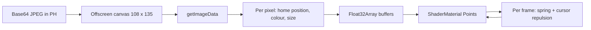

# Srivathsa Sherla — Portfolio

A portfolio you can poke at. The portrait is about 14,600 WebGL particles that part around your cursor, and the Learning section is a working terminal. One `index.html`, no build step.

**Live:** https://srivathsa12.github.io/my-portfolio/


[](https://github.com/srivathsa12/my-portfolio/actions)

> **Built with AI, openly.** I steer and review. An AI assistant (Claude, by Anthropic) wrote the code from my prompts. I did not write it line by line, and it has not had a human line-by-line review. I use it as a codebase to learn from: CSS 3D, canvas pixel reading, Three.js and Git.

## Choose your path

| You are... | Start here |
| --- | --- |
| Just visiting | [Try this](#try-this) |
| Hiring or reviewing | [Who I am](#who-i-am), [Engineering notes](#engineering-notes), [Trade-offs](#trade-offs) |
| Forking it for yourself | [Quick start](#quick-start), [Make it yours](#make-it-yours-in-5-minutes), [Deploy](#deploy-to-github-pages) |
| Curious how it works | [How it works](#how-it-works), [Tuning knobs](#tuning-knobs) |
| Something is broken | [Troubleshooting](#troubleshooting), [FAQ](#faq) |

## Who I am

B.Tech Computer Science and Engineering (AI & ML) student, class of 2030, at Newton School of Technology, S-VYASA University, Bengaluru. Originally from Hyderabad. I am exploring agentic AI, LLM workflows and automation with Python. More repositories are on [my GitHub](https://github.com/srivathsa12).

## Try this

| Do this | You get |
| --- | --- |
| Move over the portrait | A lens shows the real photo while particles part around it |
| Click the portrait | Every particle gets a random impulse, then springs back |
| Press `1` to `6` | Jump to a section |
| Drag the skill sphere | Spin 18 tags in 3D |
| Click the profile card | It flips to show my contact details |
| Terminal: `tour` | Walks through every learning module |
| Terminal: `projects` | Prints my repository links |
| Terminal: `sudo hire srivathsa` | A hidden command |

## Quick start

```bash
git clone https://github.com/srivathsa12/my-portfolio.git
cd my-portfolio
python3 -m http.server 8000   # then open http://localhost:8000
```

Opening `index.html` directly also works. Internet is needed for Three.js and the Inter font.

## Make it yours in 5 minutes

All content sits in plain JavaScript arrays inside `index.html`. Use your editor's search for the names below.

- [ ] `PH`: your photo as a base64 JPEG, or a file path if you serve over HTTP(S)
- [ ] `P`: projects
- [ ] `S`: impact stats
- [ ] `M`: learning modules (inside the terminal block)
- [ ] `L`: the 18 skill sphere tags
- [ ] `--em` and `--em2` in `:root`, plus `EM` in the Three.js block, for the accent colour
- [ ] Search `sherlasrivathsa12` and `srivathsa-sherla`, and replace my email and links
- [ ] Change the hero headline and bio text
- [ ] Add an AI credit to the footer if AI helps you too

<details>
<summary><b>Data formats for P, S and M</b></summary>

```js
// P: projects
[title, description, statusPill, techPill, codeSnippet, repoUrl]
// repoUrl is "" when there is no public repository

// S: impact stats
[label, value, suffix, ringFraction, caption]
// ringFraction is 0 to 1. The "Total XP" entry renders as a segmented bar instead of a ring.

// M: learning modules
[key, title, provider, type, description, skills[], outputLines[]]
// outputLines may be ["GRID"] to render the 100-cell day grid

// L: skill sphere tags
["Python", "JavaScript", ...]   // 18 strings
```

If you replace `PH` with a file path, serve the site over HTTP(S). Browsers can block reading pixels from local files, and the particle portrait needs them.
</details>

## Deploy to GitHub Pages

1. Make the repository **public**.
2. Go to **Settings → Pages → Build and deployment**.
3. Set **Source** to **Deploy from a branch**.
4. In the **Branch** dropdown choose `main` (it says `None` at first), keep `/ (root)`, and click **Save**.
5. Open the **Actions** tab and wait for "pages build and deployment" to turn green.
6. Visit `https://<your-username>.github.io/<repo-name>/`.

Ignore the "Visibility" box with the Enterprise label. That is a paid feature for private sites and you do not need it.

To update the live site later:

```bash
git add index.html
git commit -m "Update projects"
git push
```

Pages redeploys in a minute or two.

<details>
<summary><b>Keep junk out of the repo</b></summary>

macOS adds `.DS_Store` files. Remove one that is already committed and ignore it from now on:

```bash
git rm --cached .DS_Store
printf ".DS_Store\n" >> .gitignore
git add .gitignore
git commit -m "Remove .DS_Store and ignore it"
git push
```

If AI helped write a commit, you can say so with a trailer line in the commit message:

```text
Co-authored-by: Claude <noreply@anthropic.com>
```
</details>

## Troubleshooting

| Symptom | Cause | Fix |
| --- | --- | --- |
| "There isn't a GitHub Pages site here" | Pages is off, or the Branch selector still says `None` | Follow the deploy steps above |
| Pages options greyed out or ask to upgrade | The repository is private | Change visibility to public |
| 404 right after saving | The first build has not finished | Wait for the green Actions run, then hard refresh (Cmd/Ctrl + Shift + R) |
| Page loads, no 3D portrait or background | The Three.js CDN is blocked or you are offline | Open the browser console and network tab, then check `cdnjs.cloudflare.com` |
| The portrait stays a scattered cloud | Still settling on a slow device, or the cursor is parked over it | Wait a few seconds and move the cursor away |
| Portrait is empty after you changed `PH` | The image could not be read into a canvas | Use a base64 value, or serve over HTTP(S) |
| Page is slow or the fan spins up | Too many particles for the device | See [Tuning knobs](#tuning-knobs) |
| Changes do not show on the live site | Cached copy, or the deploy has not run | Check the Actions tab, then hard refresh |

## How it works

```text
┌─ browser ──────────────────────────────────────────────┐
│ <canvas id="gl">   fixed, behind the page              │  Three.js: particles, network, rings
│ <main> sections    scrolls over the canvas             │  HTML plus JS-built cards and terminal
│ cursor light, grain, intro curtain (no pointer events) │
└────────────────────────────────────────────────────────┘
```



1. The photo is drawn to a small offscreen canvas and every pixel is read.
2. Each pixel becomes one point. Brightness sets its size and depth, so the image reads as a halftone relief.
3. Every frame, each point is pulled toward its home position by a spring and pushed away from the cursor inside a fixed radius.
4. The WebGL group is placed from the on-screen rectangle of the portrait element, so it follows the page as it scrolls.

<details>
<summary><b>Script blocks in index.html, in order</b></summary>

| Block | Responsibility |
| --- | --- |
| Headline | Splits the `<h1>` into letters and sets a CSS variable per letter from cursor distance |
| Typing ticker | Cycles four command strings in the hero |
| Portrait lens | A DOM circle that follows the pointer and shows the unmodified photo |
| Projects | Builds the cards from `P` |
| Stats | Builds the stat cards from `S` and animates rings, segments and counters |
| Learning terminal | Command parser, module output, history and the 100-cell day grid |
| Skill sphere | Places tags on a Fibonacci sphere and rotates them with plain trigonometry |
| Interaction layer | Card tilt, holographic sheen, magnetic buttons, cursor light, navigation state |
| Final touches | Cursor ring, marquee skew, contact marquee, copy email, IST clock, keyboard shortcuts |
| Three.js scene | Particle portrait, drifting node network, gyroscope rings |
</details>

<details>
<summary><b>Terminal command reference</b></summary>

| Command | Result |
| --- | --- |
| `help` | List commands |
| `ls` | List the six modules |
| `cat <module>` | Open a module: `python`, `git`, `100days`, `genai`, `evals`, `agentic` |
| `tour` | Walk through every module in order |
| `projects` | Print repository links |
| `whoami` | Short profile |
| `github` | Profile and repository links |
| `about`, `skills`, `work`, `impact`, `contact` | Scroll to that section |
| `clear` | Clear the screen |

Up and down arrows step through history. The module cards on the left run the same commands.
</details>

## Tuning knobs

Constants you can change in the Three.js block to trade looks for speed. Edit one at a time and reload.

| Constant | Current | Effect |
| --- | --- | --- |
| `COLS`, `ROWS` | `108`, `135` | Particle count (14,580). Keep the 4:5 ratio, for example `72` and `90` gives 6,480 |
| `N` | `70` | Background nodes. Pair checks per frame grow with N² |
| `MAXL` | `300` | Maximum network lines drawn |
| Repulsion radius and strength | `.17`, `.012` | How far and how hard the cursor pushes particles |
| Spring and damping | `.07`, `.86` | How fast particles return, and how much they overshoot |
| Click impulse | `.07` | How violently a click scatters the portrait |
| Pixel ratio cap | `2` | Lower it to `1` for a big speed gain on high-density screens |
| Line distance | `6` (squared) | How close nodes must be to connect |

## Engineering notes

Things that went wrong during the build, and what I did about them.

- **One bad block broke the whole page.** A leftover script block reused a variable name from a newer one. The browser rejected the entire script and nothing animated. I found it by loading the page in headless Chromium and reading the console. After that, every change was tested before it was published.
- **The face disappeared in the particles.** Mid-dark skin tones have low luminance, so the dots were tiny and dim. Lifting brightness with a gamma curve (`pow(x, 0.6)`) made the face readable.
- **Canvas pixel reads can be blocked.** Browsers can refuse to read pixels from images loaded from another origin or from `file://`. Embedding the photo as base64 avoids it, at the cost of a larger file (about 147 KB).
- **Software WebGL hid the real frame rate.** Automated checks ran at about 4 frames per second on a software renderer. That shows it renders, not that it is smooth. I have not benchmarked a real GPU.
- **Pages looked broken, but it was only switched off.** The 404 was the Branch dropdown still set to `None`, not a code problem.

## Trade-offs

| Choice | Upside | Cost |
| --- | --- | --- |
| Single file | Easy to clone and deploy | Harder to review and diff. Split into `index.html`, `styles.css` and `app.js` as it grows |
| Three.js r128 from a CDN | No install step | A network dependency and an old version |
| CPU particle simulation | Simple to read | Scales worse than a GPU shader on weak devices |
| Base64 photo | No cross-origin problems | Larger file, and changing the photo means editing a long string |

## Compatibility

Needs a recent browser with WebGL, CSS `color-mix()`, the individual `scale` property and `:focus-visible`. I have only tested Chromium. Safari and Firefox are untested. Full behaviour needs JavaScript. Without Three.js or WebGL the particle portrait and background do not render, and the rest of the page still works.

## Accessibility status

| Done | Not yet |
| --- | --- |
| `lang="en"`, one `<h1>`, `main` and `section` landmarks | Skip link |
| Decorative layers hidden with `aria-hidden` | Mobile navigation menu (links hidden under 900 px) |
| `aria-label` on the portrait stage and skill sphere, `aria-live` terminal log | Keyboard support for the profile card flip |
| Visible `:focus-visible` outline | Colour contrast audit |
| `prefers-reduced-motion` disables animations and the intro curtain | Meta description, Open Graph tags, favicon |
| Custom cursor disabled on devices without hover | Automated tests |

## FAQ

<details>
<summary><b>Can I copy this for my own portfolio?</b></summary>

There is no license file yet, so default copyright applies. Open an issue or email me and I will add a license. Please replace all personal content, including my photo, name and links.
</details>

<details>
<summary><b>Why is it one file?</b></summary>

To make it easy to clone, deploy and read top to bottom. The trade-off is in the table above.
</details>

<details>
<summary><b>How much of this is AI-written?</b></summary>

Essentially all of the code. My part is the direction, the photo, the profile data, the review of every iteration, and the repository and deployment. Facts about me come from my own records.
</details>

<details>
<summary><b>Why do some project cards have no link?</b></summary>

"Agentic Social Media Automation" has no public repository. "Digital Door Lock System" is a documented design, not a built device. The status labels on the page say this.
</details>

<details>
<summary><b>How do I add a project?</b></summary>

Add a row to the `P` array following the format above. The cards are built from that array, so no markup changes are needed.
</details>

## Roadmap

- [ ] Mobile navigation menu
- [ ] Keyboard support for the profile card flip
- [ ] Skip link, meta description, Open Graph tags and favicon
- [ ] Contrast and Lighthouse audit
- [ ] Reduce particle count automatically on low-end devices
- [ ] Self-host Three.js and the font
- [ ] Add a screenshot or short GIF to this README
- [ ] Add a LICENSE file

## Credits

[Three.js](https://threejs.org/) for the WebGL layer, [Inter](https://rsms.me/inter/) for typography, [Shields.io](https://shields.io/) for badges, and Claude by [Anthropic](https://www.anthropic.com/) for generating the code.

## Contact

[sherlasrivathsa12@gmail.com](mailto:sherlasrivathsa12@gmail.com) · [GitHub](https://github.com/srivathsa12) · [LinkedIn](https://www.linkedin.com/in/srivathsa-sherla)